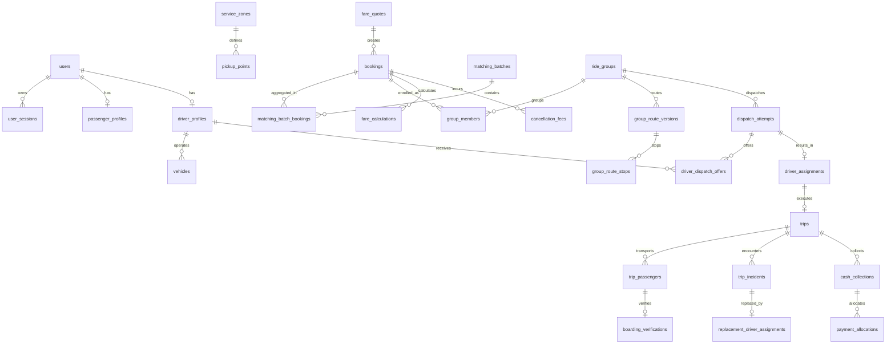
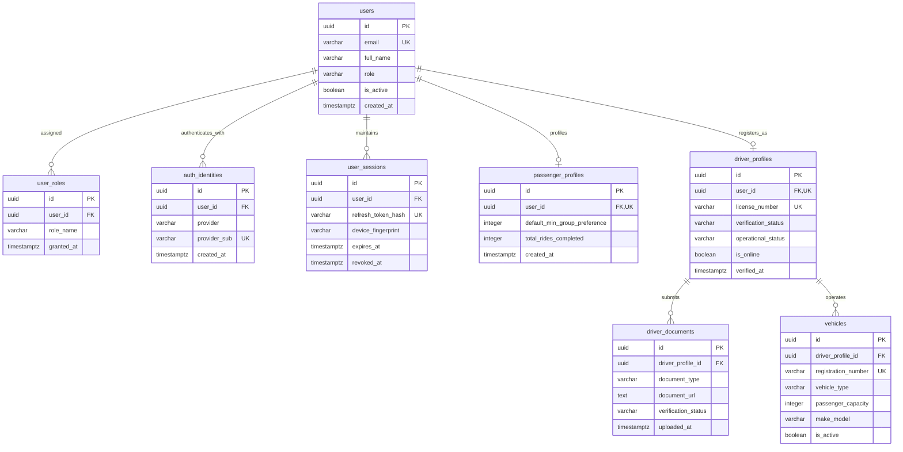
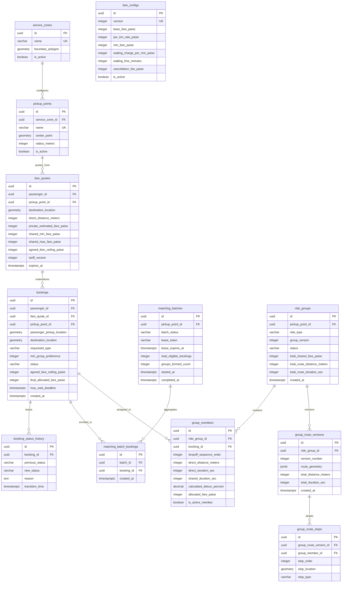
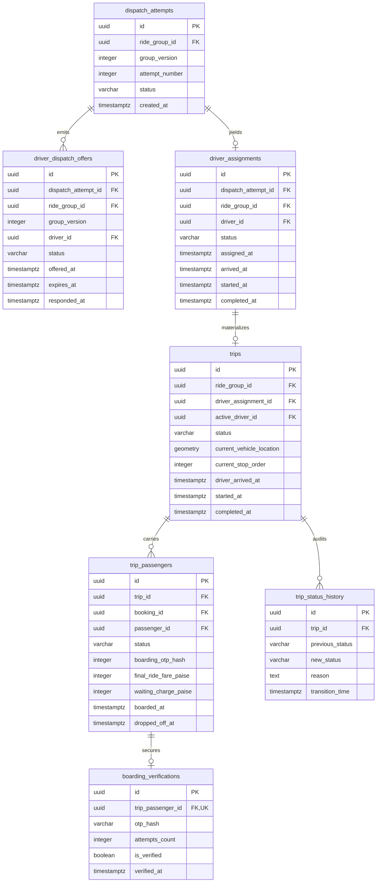
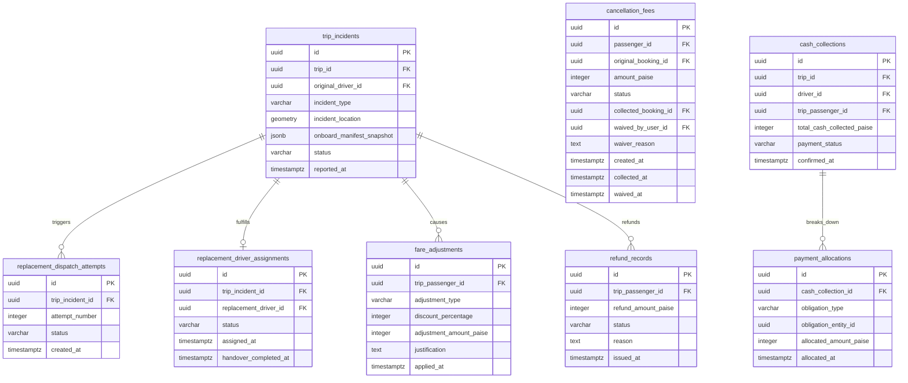

# Database Design Specification

## On-Demand Aggregation Platform for Last-Mile Connectivity Using Shared Micro-Mobility

---

## 1. Storage Strategy and Relational Architecture

The data architecture adheres to a strict division of responsibilities:
1. **Authoritative Persistence Layer (PostgreSQL 16+ & PostGIS 3.4+):**
   - Serves as the sole authoritative single source of truth for all business entities, financial ledgers, booking lifecycles, and driver assignments.
   - All critical state transitions execute under ACID transaction boundaries.
   - Geospatial operations (geofence distance validation and service polygon containment) are computed natively using PostGIS spatial functions on **SRID 4326** (WGS 84).
2. **Ephemeral In-Memory Cache Layer (Redis 7.2+):**
   - Caches volatile real-time driver GPS coordinates with an automated 30-second TTL.
   - Backs BullMQ job queues and distributed batch execution leases (`lease:matching:pdeu`).
   - Contains no irreversible business state; if Redis is completely flushed or restarted, PostgreSQL retains 100% of platform data integrity.
3. **ORM & Query Execution Strategy (Prisma ORM & Controlled Raw SQL):**
   - Standard CRUD operations, type generation, and relational navigation are managed via Prisma.
   - Raw SQL (`$queryRaw` and `$executeRaw`) is strictly utilized for:
     - PostGIS spatial functions (`ST_DWithin`, `ST_Contains`, `ST_MakePoint`).
     - Pessimistic row-level locking (`SELECT ... FOR UPDATE`).
     - Outbox queue claiming with `SELECT ... FOR UPDATE SKIP LOCKED`.
     - Partial unique index enforcement and conditional atomic updates.
4. **Standard Field Conventions:**
   - **Identifiers:** Canonical UUIDv4 strings (`gen_random_uuid()`).
   - **Monetary Amounts:** High-precision integer **paise** (`INTEGER` or `BIGINT`) where 100 paise = ₹1.00. Floating-point money calculations are strictly prohibited.
   - **Distances:** Integer road distances in **metres**.
   - **Timestamps:** PostgreSQL `TIMESTAMPTZ` stored in UTC.

---

## 2. Entity-Relationship Diagrams (Mermaid ERD)

### 2.1 Overall Conceptual ER Diagram


### 2.2 Identity and Onboarding ER Diagram


### 2.3 Booking, Matching and Grouping ER Diagram


### 2.4 Dispatch and Trip Lifecycle ER Diagram


### 2.5 Finance and Incident Management ER Diagram


---

## 3. Comprehensive Entity Data Dictionary

### 3.1 Central Identity and Onboarding

#### `users`
- **Purpose:** Primary identity records for all system actors.
- **Columns:**
  - `id` (`UUID`, PK, `DEFAULT gen_random_uuid()`): Immutable identifier.
  - `email` (`VARCHAR(255)`, NOT NULL, UNIQUE): Verified email.
  - `full_name` (`VARCHAR(255)`, NOT NULL): Display name.
  - `role` (`VARCHAR(50)`, NOT NULL, DEFAULT `'PASSENGER'`): Primary role: `'PASSENGER'`, `'DRIVER'`, `'ADMIN'`.
  - `phone_number` (`VARCHAR(20)`, NULL): Optional contact phone.
  - `avatar_url` (`TEXT`, NULL): Profile image URL.
  - `is_active` (`BOOLEAN`, NOT NULL, DEFAULT `true`): Account state.
  - `created_at` (`TIMESTAMPTZ`, NOT NULL, DEFAULT `NOW()`): Record creation.
  - `updated_at` (`TIMESTAMPTZ`, NOT NULL, DEFAULT `NOW()`): Last update.

#### `auth_identities`
- **Purpose:** Maps external Google OAuth subjects to internal users.
- **Columns:**
  - `id` (`UUID`, PK): Primary key.
  - `user_id` (`UUID`, NOT NULL, FK $\rightarrow$ `users.id` ON DELETE CASCADE): User reference.
  - `provider` (`VARCHAR(50)`, NOT NULL, DEFAULT `'GOOGLE'`): OAuth provider.
  - `provider_sub` (`VARCHAR(255)`, NOT NULL, UNIQUE): Immutable Google `sub` identifier.
  - `created_at` (`TIMESTAMPTZ`, NOT NULL, DEFAULT `NOW()`): Creation timestamp.

#### `user_sessions`
- **Purpose:** Securely tracks active refresh tokens for session rotation and reuse detection.
- **Columns:**
  - `id` (`UUID`, PK): Primary key.
  - `user_id` (`UUID`, NOT NULL, FK $\rightarrow$ `users.id` ON DELETE CASCADE): User reference.
  - `token_family_id` (`UUID`, NOT NULL): Token family UUID for reuse detection.
  - `refresh_token_hash` (`VARCHAR(255)`, NOT NULL, UNIQUE): SHA-256 hash of refresh token.
  - `device_fingerprint` (`VARCHAR(255)`, NULL): Device context.
  - `expires_at` (`TIMESTAMPTZ`, NOT NULL): Absolute session expiration (max 30 days).
  - `revoked_at` (`TIMESTAMPTZ`, NULL): Revocation timestamp.
  - `created_at` (`TIMESTAMPTZ`, NOT NULL, DEFAULT `NOW()`): Issuance timestamp.

#### `driver_profiles`
- **Purpose:** Driver-specific operational state and verification metadata.
- **Columns:**
  - `id` (`UUID`, PK): Primary key.
  - `user_id` (`UUID`, NOT NULL, UNIQUE, FK $\rightarrow$ `users.id` ON DELETE RESTRICT): Associated user.
  - `license_number` (`VARCHAR(100)`, NOT NULL, UNIQUE): Driving license identifier.
  - `verification_status` (`VARCHAR(50)`, NOT NULL, DEFAULT `'PENDING'`): `'PENDING'`, `'APPROVED'`, `'REJECTED'`, `'SUSPENDED'`.
  - `operational_status` (`VARCHAR(50)`, NOT NULL, DEFAULT `'OFFLINE'`): `'OFFLINE'`, `'AVAILABLE'`, `'RESERVED'`, `'ON_TRIP'`.
  - `is_online` (`BOOLEAN`, NOT NULL, DEFAULT `false`): Manual online toggle.
  - `verified_at` (`TIMESTAMPTZ`, NULL): Admin verification timestamp.
  - `verified_by_user_id` (`UUID`, NULL, FK $\rightarrow$ `users.id`): Reviewing admin.
  - `rejection_reason` (`TEXT`, NULL): Reason if rejected or suspended.
  - `created_at` (`TIMESTAMPTZ`, NOT NULL, DEFAULT `NOW()`): Creation timestamp.
  - `updated_at` (`TIMESTAMPTZ`, NOT NULL, DEFAULT `NOW()`): Last update.

#### `driver_documents`
- **Purpose:** Storage references for driving licenses and vehicle RC certificates.
- **Columns:**
  - `id` (`UUID`, PK): Primary key.
  - `driver_profile_id` (`UUID`, NOT NULL, FK $\rightarrow$ `driver_profiles.id` ON DELETE CASCADE): Driver reference.
  - `document_type` (`VARCHAR(50)`, NOT NULL): `'DRIVING_LICENSE'`, `'VEHICLE_RC'`, `'VEHICLE_INSURANCE'`.
  - `document_url` (`TEXT`, NOT NULL): Storage location path.
  - `verification_status` (`VARCHAR(50)`, NOT NULL, DEFAULT `'PENDING'`): Status.
  - `uploaded_at` (`TIMESTAMPTZ`, NOT NULL, DEFAULT `NOW()`): Upload timestamp.

#### `vehicles`
- **Purpose:** Physical vehicle details and certified seating capacity.
- **Columns:**
  - `id` (`UUID`, PK): Primary key.
  - `driver_profile_id` (`UUID`, NOT NULL, FK $\rightarrow$ `driver_profiles.id` ON DELETE RESTRICT): Driver owner.
  - `registration_number` (`VARCHAR(50)`, NOT NULL, UNIQUE): License plate (e.g. GJ-01-XX-XXXX).
  - `vehicle_type` (`VARCHAR(50)`, NOT NULL, DEFAULT `'E_RICKSHAW'`): `'E_RICKSHAW'`, `'BIKE_TAXI'`, `'SHUTTLE_VAN'`.
  - `passenger_capacity` (`INTEGER`, NOT NULL, CHECK (`passenger_capacity >= 1 AND passenger_capacity <= 8`)): Maximum seats (default: 4).
  - `make_model` (`VARCHAR(100)`, NOT NULL): Vehicle description.
  - `is_active` (`BOOLEAN`, NOT NULL, DEFAULT `true`): Active status.
  - `created_at` (`TIMESTAMPTZ`, NOT NULL, DEFAULT `NOW()`): Creation timestamp.

---

### 3.2 Location and Tariff Configuration

#### `service_zones`
- **Purpose:** PostGIS bounding polygons for authorized operation (e.g. Gandhinagar service region).
- **Columns:**
  - `id` (`UUID`, PK): Primary key.
  - `name` (`VARCHAR(100)`, NOT NULL, UNIQUE): Name.
  - `boundary_polygon` (`geometry(Polygon, 4326)`, NOT NULL): Service boundary polygon.
  - `is_active` (`BOOLEAN`, NOT NULL, DEFAULT `true`): Status.
  - `created_at` (`TIMESTAMPTZ`, NOT NULL, DEFAULT `NOW()`): Creation timestamp.

#### `pickup_points`
- **Purpose:** Predefined authorized transit aggregation hubs (e.g. PDEU Main Gate).
- **Columns:**
  - `id` (`UUID`, PK): Primary key.
  - `service_zone_id` (`UUID`, NOT NULL, FK $\rightarrow$ `service_zones.id`): Owning zone.
  - `name` (`VARCHAR(100)`, NOT NULL, UNIQUE): Point name.
  - `center_point` (`geometry(Point, 4326)`, NOT NULL): PostGIS center coordinate.
  - `radius_meters` (`INTEGER`, NOT NULL, DEFAULT `150`): Geofence radius in metres.
  - `is_active` (`BOOLEAN`, NOT NULL, DEFAULT `true`): Status.
  - `created_at` (`TIMESTAMPTZ`, NOT NULL, DEFAULT `NOW()`): Creation timestamp.

#### `fare_configs`
- **Purpose:** Versioned, immutable tariff configuration.
- **Columns:**
  - `id` (`UUID`, PK): Primary key.
  - `version` (`INTEGER`, NOT NULL, UNIQUE): Version number.
  - `base_fare_paise` (`INTEGER`, NOT NULL, DEFAULT `2000`): Base fare (₹20.00 = 2000 paise).
  - `per_km_rate_paise` (`INTEGER`, NOT NULL, DEFAULT `1000`): Rate per km (₹10.00/km = 1000 paise).
  - `min_fare_paise` (`INTEGER`, NOT NULL, DEFAULT `2000`): Minimum fare floor (2000 paise).
  - `waiting_charge_per_min_paise` (`INTEGER`, NOT NULL, DEFAULT `500`): ₹5.00/minute (500 paise).
  - `waiting_free_minutes` (`INTEGER`, NOT NULL, DEFAULT `5`): Free waiting window (5 min).
  - `cancellation_fee_paise` (`INTEGER`, NOT NULL, DEFAULT `3000`): Late fee (₹30.00 = 3000 paise).
  - `is_active` (`BOOLEAN`, NOT NULL, DEFAULT `true`): Active flag.
  - `created_at` (`TIMESTAMPTZ`, NOT NULL, DEFAULT `NOW()`): Creation timestamp.

---

### 3.3 Bookings and Fare Quotes

#### `fare_quotes`
- **Purpose:** Immutable 2-minute fare estimates establishing the agreed fare ceiling.
- **Columns:**
  - `id` (`UUID`, PK): Primary key.
  - `passenger_id` (`UUID`, NOT NULL, FK $\rightarrow$ `users.id`): Passenger.
  - `pickup_point_id` (`UUID`, NOT NULL, FK $\rightarrow$ `pickup_points.id`): Pickup hub.
  - `destination_location` (`geometry(Point, 4326)`, NOT NULL): Destination.
  - `direct_distance_meters` (`INTEGER`, NOT NULL): Direct road distance via OSRM.
  - `direct_duration_sec` (`INTEGER`, NOT NULL): Direct duration in seconds.
  - `private_estimated_fare_paise` (`INTEGER`, NOT NULL): Private fare in paise.
  - `shared_min_fare_paise` (`INTEGER`, NOT NULL, DEFAULT `2000`): Shared lower bound (₹20 = 2000 paise).
  - `shared_max_fare_paise` (`INTEGER`, NOT NULL): Shared upper bound (equal to private fare).
  - `agreed_fare_ceiling_paise` (`INTEGER`, NOT NULL): Absolute agreed ceiling.
  - `tariff_version` (`INTEGER`, NOT NULL): Config version snapshot.
  - `expires_at` (`TIMESTAMPTZ`, NOT NULL): Hard quote expiry (creation + 2 minutes).
  - `created_at` (`TIMESTAMPTZ`, NOT NULL, DEFAULT `NOW()`): Creation timestamp.

#### `bookings`
- **Purpose:** Authoritative individual ride requests created by passengers.
- **Columns:**
  - `id` (`UUID`, PK): Primary key.
  - `passenger_id` (`UUID`, NOT NULL, FK $\rightarrow$ `users.id` ON DELETE RESTRICT): Commuter.
  - `fare_quote_id` (`UUID`, NOT NULL, FK $\rightarrow$ `fare_quotes.id`): Originating quote.
  - `pickup_point_id` (`UUID`, NOT NULL, FK $\rightarrow$ `pickup_points.id`): Configured pickup point.
  - `passenger_pickup_location` (`geometry(Point, 4326)`, NOT NULL): Device GPS fix at booking.
  - `destination_location` (`geometry(Point, 4326)`, NOT NULL): Destination coordinate.
  - `requested_type` (`VARCHAR(20)`, NOT NULL, CHECK (`requested_type IN ('SHARED', 'PRIVATE')`)): Mode.
  - `min_group_preference` (`INTEGER`, NOT NULL, DEFAULT `2`, CHECK (`min_group_preference IN (2, 3, 4)`)): Min group size.
  - `status` (`VARCHAR(50)`, NOT NULL, DEFAULT `'REQUESTED'`): `'REQUESTED'`, `'MATCHING'`, `'DISPATCHING'`, `'CONFIRMED'`, `'IN_PROGRESS'`, `'COMPLETED'`, `'CANCELLED'`, `'EXPIRED'`, `'NO_DRIVER_AVAILABLE'`.
  - `agreed_fare_ceiling_paise` (`INTEGER`, NOT NULL): Immutable ceiling from quote.
  - `final_allocated_fare_paise` (`INTEGER`, NULL): Actual allocated fare.
  - `max_wait_deadline` (`TIMESTAMPTZ`, NOT NULL): Booking creation + 120 seconds.
  - `cancellation_reason` (`TEXT`, NULL): Reason if cancelled.
  - `cancelled_at` (`TIMESTAMPTZ`, NULL): Cancellation timestamp.
  - `created_at` (`TIMESTAMPTZ`, NOT NULL, DEFAULT `NOW()`): Creation timestamp.
  - `updated_at` (`TIMESTAMPTZ`, NOT NULL, DEFAULT `NOW()`): Last update.

---

### 3.4 Matching and Grouping

#### `matching_batches`
- **Purpose:** Audit trail of periodic 60s matching batch runs per pickup point.
- **Columns:**
  - `id` (`UUID`, PK): Primary key.
  - `pickup_point_id` (`UUID`, NOT NULL, FK $\rightarrow$ `pickup_points.id`): Pickup hub.
  - `batch_status` (`VARCHAR(50)`, NOT NULL, DEFAULT `'PENDING'`): `'PENDING'`, `'PROCESSING'`, `'COMPLETED'`, `'FAILED'`.
  - `lease_token` (`VARCHAR(255)`, NULL): Worker token holding distributed lock.
  - `lease_expires_at` (`TIMESTAMPTZ`, NULL): Lease timeout.
  - `total_eligible_bookings` (`INTEGER`, NOT NULL, DEFAULT `0`): Eligible pool size.
  - `groups_formed_count` (`INTEGER`, NOT NULL, DEFAULT `0`): Formed groups count.
  - `started_at` (`TIMESTAMPTZ`, NOT NULL, DEFAULT `NOW()`): Batch start.
  - `completed_at` (`TIMESTAMPTZ`, NULL): Batch end.

#### `matching_batch_bookings`
- **Purpose:** Join table linking claimed bookings to matching batches.
- **Columns:**
  - `id` (`UUID`, PK): Primary key.
  - `batch_id` (`UUID`, NOT NULL, FK $\rightarrow$ `matching_batches.id` ON DELETE CASCADE): Batch.
  - `booking_id` (`UUID`, NOT NULL, FK $\rightarrow$ `bookings.id` ON DELETE RESTRICT): Booking.
  - `created_at` (`TIMESTAMPTZ`, NOT NULL, DEFAULT `NOW()`): Inclusion timestamp.

#### `ride_groups`
- **Purpose:** Multi-passenger shared groups or single-passenger private groups.
- **Columns:**
  - `id` (`UUID`, PK): Primary key.
  - `pickup_point_id` (`UUID`, NOT NULL, FK $\rightarrow$ `pickup_points.id`): Starting hub.
  - `ride_type` (`VARCHAR(20)`, NOT NULL, DEFAULT `'SHARED'`, CHECK (`ride_type IN ('SHARED', 'PRIVATE')`)): Mode.
  - `group_version` (`INTEGER`, NOT NULL, DEFAULT `1`): Monotonically incrementing version.
  - `status` (`VARCHAR(50)`, NOT NULL, DEFAULT `'READY_FOR_DISPATCH'`): `'READY_FOR_DISPATCH'`, `'DISPATCHING'`, `'DRIVER_ASSIGNED'`, `'IN_PROGRESS'`, `'COMPLETED'`, `'DISSOLVED'`, `'CANCELLED'`.
  - `total_shared_fare_paise` (`INTEGER`, NOT NULL): Group fare $G$.
  - `total_route_distance_meters` (`INTEGER`, NOT NULL): Shared route distance.
  - `total_route_duration_sec` (`INTEGER`, NOT NULL): Shared route duration.
  - `created_at` (`TIMESTAMPTZ`, NOT NULL, DEFAULT `NOW()`): Creation timestamp.
  - `updated_at` (`TIMESTAMPTZ`, NOT NULL, DEFAULT `NOW()`): Last update.

#### `group_members`
- **Purpose:** Relates individual bookings to a `ride_group` and tracks detour and sequence.
- **Columns:**
  - `id` (`UUID`, PK): Primary key.
  - `ride_group_id` (`UUID`, NOT NULL, FK $\rightarrow$ `ride_groups.id` ON DELETE CASCADE): Owning group.
  - `booking_id` (`UUID`, NOT NULL, FK $\rightarrow$ `bookings.id` ON DELETE RESTRICT): Enrolled booking.
  - `dropoff_sequence_order` (`INTEGER`, NOT NULL, CHECK (`dropoff_sequence_order >= 1 AND dropoff_sequence_order <= 4`)): Stop index.
  - `direct_distance_meters` (`INTEGER`, NOT NULL): Direct road distance.
  - `direct_duration_sec` (`INTEGER`, NOT NULL): Direct duration in seconds.
  - `shared_duration_sec` (`INTEGER`, NOT NULL): Duration to this stop in shared ride.
  - `calculated_detour_percent` (`DECIMAL(5,2)`, NOT NULL, CHECK (`calculated_detour_percent <= 25.00`)): Detour ($\le 25\%$).
  - `allocated_fare_paise` (`INTEGER`, NOT NULL): Allocated fare in paise.
  - `is_active_member` (`BOOLEAN`, NOT NULL, DEFAULT `true`): False if member cancels.
  - `created_at` (`TIMESTAMPTZ`, NOT NULL, DEFAULT `NOW()`): Creation timestamp.

#### `group_route_versions`
- **Purpose:** Immutable geometric snapshots of routes for each group version.
- **Columns:**
  - `id` (`UUID`, PK): Primary key.
  - `ride_group_id` (`UUID`, NOT NULL, FK $\rightarrow$ `ride_groups.id` ON DELETE CASCADE): Group.
  - `version_number` (`INTEGER`, NOT NULL): Version number.
  - `route_geometry` (`jsonb`, NOT NULL): GeoJSON LineString of OSRM route.
  - `total_distance_meters` (`INTEGER`, NOT NULL): Distance in metres.
  - `total_duration_sec` (`INTEGER`, NOT NULL): Duration in seconds.
  - `created_at` (`TIMESTAMPTZ`, NOT NULL, DEFAULT `NOW()`): Snapshot timestamp.

#### `group_route_stops`
- **Purpose:** Sequence of drop-off stops associated with an immutable route version.
- **Columns:**
  - `id` (`UUID`, PK): Primary key.
  - `group_route_version_id` (`UUID`, NOT NULL, FK $\rightarrow$ `group_route_versions.id` ON DELETE CASCADE): Route version.
  - `group_member_id` (`UUID`, NOT NULL, FK $\rightarrow$ `group_members.id` ON DELETE CASCADE): Member.
  - `stop_order` (`INTEGER`, NOT NULL): Sequence order.
  - `stop_location` (`geometry(Point, 4326)`, NOT NULL): Stop coordinate.
  - `stop_type` (`VARCHAR(20)`, NOT NULL, DEFAULT `'DROPOFF'`): `'PICKUP'`, `'DROPOFF'`.

---

### 3.5 Dispatch and Trips

#### `dispatch_attempts`
- **Purpose:** Groups sequential 1-to-1 driver offers for a specific group version.
- **Columns:**
  - `id` (`UUID`, PK): Primary key.
  - `ride_group_id` (`UUID`, NOT NULL, FK $\rightarrow$ `ride_groups.id` ON DELETE CASCADE): Target group.
  - `group_version` (`INTEGER`, NOT NULL): Version of group at dispatch.
  - `attempt_number` (`INTEGER`, NOT NULL, DEFAULT `1`): Sequential attempt count.
  - `status` (`VARCHAR(50)`, NOT NULL, DEFAULT `'ACTIVE'`): `'ACTIVE'`, `'SUCCEEDED'`, `'EXHAUSTED'`.
  - `created_at` (`TIMESTAMPTZ`, NOT NULL, DEFAULT `NOW()`): Creation timestamp.

#### `driver_dispatch_offers`
- **Purpose:** Records sequential 1-to-1 driver offers with a 20-second timeout.
- **Columns:**
  - `id` (`UUID`, PK): Primary key.
  - `dispatch_attempt_id` (`UUID`, NOT NULL, FK $\rightarrow$ `dispatch_attempts.id` ON DELETE CASCADE): Attempt.
  - `ride_group_id` (`UUID`, NOT NULL, FK $\rightarrow$ `ride_groups.id` ON DELETE CASCADE): Group.
  - `group_version` (`INTEGER`, NOT NULL): Group version.
  - `driver_id` (`UUID`, NOT NULL, FK $\rightarrow$ `driver_profiles.id` ON DELETE RESTRICT): Target driver.
  - `status` (`VARCHAR(50)`, NOT NULL, DEFAULT `'PENDING'`): `'PENDING'`, `'ACCEPTED'`, `'REJECTED'`, `'EXPIRED'`, `'WITHDRAWN'`.
  - `offered_at` (`TIMESTAMPTZ`, NOT NULL, DEFAULT `NOW()`): Offer creation.
  - `expires_at` (`TIMESTAMPTZ`, NOT NULL): `offered_at` + 20 seconds.
  - `responded_at` (`TIMESTAMPTZ`, NULL): Driver response timestamp.

#### `driver_assignments`
- **Purpose:** Durable association of an accepted driver to a ride group.
- **Columns:**
  - `id` (`UUID`, PK): Primary key.
  - `dispatch_attempt_id` (`UUID`, NOT NULL, FK $\rightarrow$ `dispatch_attempts.id`): Attempt.
  - `ride_group_id` (`UUID`, NOT NULL, FK $\rightarrow$ `ride_groups.id`): Group.
  - `driver_id` (`UUID`, NOT NULL, FK $\rightarrow$ `driver_profiles.id`): Assigned driver.
  - `status` (`VARCHAR(50)`, NOT NULL, DEFAULT `'RESERVED'`): `'RESERVED'`, `'ACTIVE'`, `'COMPLETED'`, `'RELEASED'`, `'CANCELLED'`.
  - `assigned_at` (`TIMESTAMPTZ`, NOT NULL, DEFAULT `NOW()`): Assignment timestamp.
  - `arrived_at` (`TIMESTAMPTZ`, NULL): Driver arrival at pickup hub.
  - `started_at` (`TIMESTAMPTZ`, NULL): Trip start.
  - `completed_at` (`TIMESTAMPTZ`, NULL): Trip completion.

#### `trips`
- **Purpose:** Operational representation of the physical vehicle trip.
- **Columns:**
  - `id` (`UUID`, PK): Primary key.
  - `ride_group_id` (`UUID`, NOT NULL, FK $\rightarrow$ `ride_groups.id`): Materialized group.
  - `driver_assignment_id` (`UUID`, NOT NULL, UNIQUE, FK $\rightarrow$ `driver_assignments.id`): Winning assignment.
  - `active_driver_id` (`UUID`, NOT NULL, FK $\rightarrow$ `driver_profiles.id`): Operating driver.
  - `status` (`VARCHAR(50)`, NOT NULL, DEFAULT `'CREATED'`): `'CREATED'`, `'DRIVER_EN_ROUTE'`, `'AT_PICKUP'`, `'IN_PROGRESS'`, `'INTERRUPTED'`, `'COMPLETED'`, `'ABORTED'`, `'CANCELLED'`.
  - `current_vehicle_location` (`geometry(Point, 4326)`, NULL): Latest durable GPS.
  - `current_stop_order` (`INTEGER`, NOT NULL, DEFAULT `0`): Active drop-off stop.
  - `driver_arrived_at` (`TIMESTAMPTZ`, NULL): Authoritative arrival timestamp.
  - `started_at` (`TIMESTAMPTZ`, NULL): Boarding completion and trip start.
  - `completed_at` (`TIMESTAMPTZ`, NULL): Trip completion.
  - `created_at` (`TIMESTAMPTZ`, NOT NULL, DEFAULT `NOW()`): Creation timestamp.
  - `updated_at` (`TIMESTAMPTZ`, NOT NULL, DEFAULT `NOW()`): Last update.

#### `trip_passengers`
- **Purpose:** Independent journey lifecycle for each individual passenger onboard.
- **Columns:**
  - `id` (`UUID`, PK): Primary key.
  - `trip_id` (`UUID`, NOT NULL, FK $\rightarrow$ `trips.id` ON DELETE CASCADE): Vehicle trip.
  - `booking_id` (`UUID`, NOT NULL, FK $\rightarrow$ `bookings.id` ON DELETE RESTRICT): Booking.
  - `passenger_id` (`UUID`, NOT NULL, FK $\rightarrow$ `users.id`): Commuter.
  - `status` (`VARCHAR(50)`, NOT NULL, DEFAULT `'WAITING'`): `'WAITING'`, `'BOARDED'`, `'COMPLETED'`, `'NO_SHOW'`, `'CANCELLED'`.
  - `final_ride_fare_paise` (`INTEGER`, NOT NULL): Allocated ride fare in paise.
  - `waiting_charge_paise` (`INTEGER`, NOT NULL, DEFAULT `0`): Individual waiting charge.
  - `boarded_at` (`TIMESTAMPTZ`, NULL): Authoritative OTP verification timestamp.
  - `dropped_off_at` (`TIMESTAMPTZ`, NULL): Drop-off completion timestamp.
  - `created_at` (`TIMESTAMPTZ`, NOT NULL, DEFAULT `NOW()`): Creation timestamp.

#### `boarding_verifications`
- **Purpose:** Secure 4-digit boarding OTP management.
- **Columns:**
  - `id` (`UUID`, PK): Primary key.
  - `trip_passenger_id` (`UUID`, NOT NULL, UNIQUE, FK $\rightarrow$ `trip_passengers.id` ON DELETE CASCADE): Passenger journey.
  - `otp_hash` (`VARCHAR(255)`, NOT NULL): SHA-256 hash of 4-digit OTP.
  - `attempts_count` (`INTEGER`, NOT NULL, DEFAULT `0`): Verification attempts.
  - `max_attempts` (`INTEGER`, NOT NULL, DEFAULT `3`): Maximum allowed attempts.
  - `is_verified` (`BOOLEAN`, NOT NULL, DEFAULT `false`): Verification flag.
  - `expires_at` (`TIMESTAMPTZ`, NOT NULL): OTP expiration (driver arrival + 10m).
  - `verified_at` (`TIMESTAMPTZ`, NULL): Verification timestamp.

---

### 3.6 Financial Records and Collections

#### `cancellation_fees`
- **Purpose:** Authoritative financial ledger tracking late-cancellation and no-show penalties.
- **Columns:**
  - `id` (`UUID`, PK): Primary key.
  - `passenger_id` (`UUID`, NOT NULL, FK $\rightarrow$ `users.id` ON DELETE RESTRICT): Liable passenger.
  - `original_booking_id` (`UUID`, NOT NULL, UNIQUE, FK $\rightarrow$ `bookings.id` ON DELETE RESTRICT): Originating booking (enforced unique by `idx_unique_cancellation_fee_per_booking`).
  - `amount_paise` (`INTEGER`, NOT NULL, DEFAULT `3000`, CHECK (`amount_paise > 0`)): Fixed penalty (₹30.00 = 3000 paise).
  - `status` (`VARCHAR(50)`, NOT NULL, DEFAULT `'OUTSTANDING'`): `'OUTSTANDING'`, `'COLLECTED'`, `'WAIVED'`.
  - `collected_booking_id` (`UUID`, NULL, FK $\rightarrow$ `bookings.id`): Subsequent booking where fee was collected.
  - `waived_by_user_id` (`UUID`, NULL, FK $\rightarrow$ `users.id`): Administrator who granted waiver (authoritative waiver audit record).
  - `waiver_reason` (`TEXT`, NULL): Documented justification for waiver.
  - `created_at` (`TIMESTAMPTZ`, NOT NULL, DEFAULT `NOW()`): Creation timestamp.
  - `collected_at` (`TIMESTAMPTZ`, NULL): Collection timestamp.
  - `waived_at` (`TIMESTAMPTZ`, NULL): Waiver timestamp.

#### `cash_collections`
- **Purpose:** Audit record of physical cash collected by drivers per passenger drop-off.
- **Columns:**
  - `id` (`UUID`, PK): Primary key.
  - `trip_id` (`UUID`, NOT NULL, FK $\rightarrow$ `trips.id` ON DELETE RESTRICT): Associated trip.
  - `driver_id` (`UUID`, NOT NULL, FK $\rightarrow$ `driver_profiles.id` ON DELETE RESTRICT): Collecting driver.
  - `trip_passenger_id` (`UUID`, NOT NULL, UNIQUE, FK $\rightarrow$ `trip_passengers.id` ON DELETE RESTRICT): Passenger journey (enforced unique by `idx_unique_cash_collection_trip_passenger`).
  - `total_cash_collected_paise` (`INTEGER`, NOT NULL, CHECK (`total_cash_collected_paise >= 0`)): Total cash received.
  - `payment_status` (`VARCHAR(50)`, NOT NULL, DEFAULT `'PAID'`): `'PAID'`, `'DISPUTED'`.
  - `confirmed_at` (`TIMESTAMPTZ`, NOT NULL, DEFAULT `NOW()`): Confirmation timestamp.

#### `payment_allocations`
- **Purpose:** Detailed financial breakdown attributing a single cash collection to specific obligations.
- **Columns:**
  - `id` (`UUID`, PK): Primary key.
  - `cash_collection_id` (`UUID`, NOT NULL, FK $\rightarrow$ `cash_collections.id` ON DELETE CASCADE): Cash collection.
  - `obligation_type` (`VARCHAR(50)`, NOT NULL): `'RIDE_FARE'`, `'WAITING_CHARGE'`, `'CANCELLATION_FEE_SURCHARGE'`.
  - `obligation_entity_id` (`UUID`, NOT NULL): Reference to `trip_passengers.id` or `cancellation_fees.id`.
  - `allocated_amount_paise` (`INTEGER`, NOT NULL, CHECK (`allocated_amount_paise > 0`)): Amount allocated.
  - `allocated_at` (`TIMESTAMPTZ`, NOT NULL, DEFAULT `NOW()`): Allocation timestamp.

---

### 3.7 Incidents and Mid-Trip Failures

#### `trip_incidents`
- **Purpose:** Records mid-trip driver breakdowns, flat tires, or mechanical failures.
- **Columns:**
  - `id` (`UUID`, PK): Primary key.
  - `trip_id` (`UUID`, NOT NULL, FK $\rightarrow$ `trips.id` ON DELETE RESTRICT): Interrupted trip.
  - `original_driver_id` (`UUID`, NOT NULL, FK $\rightarrow` `driver_profiles.id`): Broken-down driver.
  - `incident_type` (`VARCHAR(50)`, NOT NULL, DEFAULT `'MECHANICAL_BREAKDOWN'`): Type.
  - `incident_location` (`geometry(Point, 4326)`, NOT NULL): Location of interruption.
  - `onboard_manifest_snapshot` (`jsonb`, NOT NULL): Immutable JSON snapshot of remaining passengers.
  - `status` (`VARCHAR(50)`, NOT NULL, DEFAULT `'REPORTED'`): `'REPORTED'`, `'DISPATCHING_REPLACEMENT'`, `'RESOLVED'`, `'ABORTED'`.
  - `reported_at` (`TIMESTAMPTZ`, NOT NULL, DEFAULT `NOW()`): Reporting timestamp.

#### `replacement_driver_assignments`
- **Purpose:** Durable association of a replacement driver to an interrupted trip incident.
- **Columns:**
  - `id` (`UUID`, PK): Primary key.
  - `trip_incident_id` (`UUID`, NOT NULL, FK $\rightarrow$ `trip_incidents.id` ON DELETE RESTRICT): Incident.
  - `replacement_driver_id` (`UUID`, NOT NULL, FK $\rightarrow$ `driver_profiles.id` ON DELETE RESTRICT): Replacement driver.
  - `status` (`VARCHAR(50)`, NOT NULL, DEFAULT `'ASSIGNED'`): `'ASSIGNED'`, `'HANDOVER_COMPLETED'`, `'CANCELLED'`.
  - `assigned_at` (`TIMESTAMPTZ`, NOT NULL, DEFAULT `NOW()`): Assignment timestamp.
  - `handover_completed_at` (`TIMESTAMPTZ`, NULL): Physical passenger transfer timestamp.

#### `fare_adjustments`
- **Purpose:** Records automatic discounts applied due to platform or trip disruptions (e.g. 10% breakdown discount).
- **Columns:**
  - `id` (`UUID`, PK): Primary key.
  - `trip_passenger_id` (`UUID`, NOT NULL, FK $\rightarrow$ `trip_passengers.id` ON DELETE CASCADE): Passenger.
  - `adjustment_type` (`VARCHAR(50)`, NOT NULL, DEFAULT `'BREAKDOWN_COMPENSATION'`): Type.
  - `discount_percentage` (`INTEGER`, NOT NULL, DEFAULT `10`): Percentage discount.
  - `adjustment_amount_paise` (`INTEGER`, NOT NULL, CHECK (`adjustment_amount_paise > 0`)): Rupee discount.
  - `justification` (`TEXT`, NOT NULL): Reason.
  - `applied_at` (`TIMESTAMPTZ`, NOT NULL, DEFAULT `NOW()`): Application timestamp.

#### `refund_records`
- **Purpose:** Records full company refunds issued when a trip is aborted without a replacement.
- **Columns:**
  - `id` (`UUID`, PK): Primary key.
  - `trip_passenger_id` (`UUID`, NOT NULL, FK $\rightarrow$ `trip_passengers.id` ON DELETE CASCADE): Passenger.
  - `refund_amount_paise` (`INTEGER`, NOT NULL, CHECK (`refund_amount_paise > 0`)): Refund in paise.
  - `status` (`VARCHAR(50)`, NOT NULL, DEFAULT `'PENDING'`): `'PENDING'`, `'COMPLETED'`.
  - `reason` (`TEXT`, NOT NULL): Justification.
  - `issued_at` (`TIMESTAMPTZ`, NOT NULL, DEFAULT `NOW()`): Issuance timestamp.

---

### 3.8 Operational and Outbox Records

#### `outbox_events`
- **Purpose:** Transactional Outbox Pattern for guaranteed event delivery to BullMQ.
- **Columns:**
  - `id` (`UUID`, PK): Primary key.
  - `event_type` (`VARCHAR(100)`, NOT NULL): Event name.
  - `aggregate_type` (`VARCHAR(100)`, NOT NULL): Domain aggregate.
  - `aggregate_id` (`UUID`, NOT NULL): Aggregate UUID.
  - `payload` (`jsonb`, NOT NULL): Serialized JSON payload.
  - `status` (`VARCHAR(50)`, NOT NULL, DEFAULT `'PENDING'`): `'PENDING'`, `'PUBLISHED'`, `'FAILED'`.
  - `retry_count` (`INTEGER`, NOT NULL, DEFAULT `0`): Retries.
  - `last_error` (`TEXT`, NULL): Failure error trace.
  - `created_at` (`TIMESTAMPTZ`, NOT NULL, DEFAULT `NOW()`): Creation timestamp.
  - `published_at` (`TIMESTAMPTZ`, NULL): BullMQ enqueue timestamp.

#### `idempotency_records`
- **Purpose:** Prevents duplicate state mutations on mutating REST endpoints.
- **Columns:**
  - `idempotency_key` (`VARCHAR(255)`, PK): Client-provided key.
  - `user_id` (`UUID`, NOT NULL, FK $\rightarrow$ `users.id`): Acting user.
  - `request_path` (`VARCHAR(255)`, NOT NULL): Endpoint URL path.
  - `request_hash` (`VARCHAR(64)`, NOT NULL): SHA-256 hash of body.
  - `status_code` (`INTEGER`, NOT NULL): Cached HTTP status.
  - `response_payload` (`jsonb`, NOT NULL): Cached response JSON.
  - `created_at` (`TIMESTAMPTZ`, NOT NULL, DEFAULT `NOW()`): Creation timestamp.

---

## 4. Critical Database Invariants and Exact Raw SQL Definitions

To guarantee zero illegal states, the following 11 database invariants are strictly enforced at the PostgreSQL database engine level:

### 4.1 Invariant 1: Exactly One Active Booking per Passenger
```sql
CREATE UNIQUE INDEX idx_unique_active_passenger_booking
ON bookings (passenger_id)
WHERE status IN ('REQUESTED', 'MATCHING', 'DISPATCHING', 'CONFIRMED', 'IN_PROGRESS');
```

### 4.2 Invariant 2: A Booking Belongs to At Most One Active Group
```sql
CREATE UNIQUE INDEX idx_unique_active_booking_in_group
ON group_members (booking_id)
WHERE is_active_member = true;
```

### 4.3 Invariant 3: Exactly One Active Assignment per Driver
```sql
CREATE UNIQUE INDEX idx_unique_active_driver_assignment
ON driver_assignments (driver_id)
WHERE status IN ('RESERVED', 'ACTIVE');
```

### 4.4 Invariant 4: Exactly One Active Assignment per Ride Group
```sql
CREATE UNIQUE INDEX idx_unique_active_group_assignment
ON driver_assignments (ride_group_id)
WHERE status IN ('RESERVED', 'ACTIVE');
```

### 4.5 Invariant 5: A Group Has At Most ONE Pending Driver Offer at a Time
```sql
CREATE UNIQUE INDEX idx_unique_single_pending_offer_per_group
ON driver_dispatch_offers (ride_group_id)
WHERE status = 'PENDING';
```

### 4.6 Invariant 6: Scoped Driver Offer Exclusion per Group Version
```sql
CREATE UNIQUE INDEX idx_unique_driver_offer_per_group_version
ON driver_dispatch_offers (ride_group_id, group_version, dispatch_attempt_id, driver_id);
```

### 4.7 Invariant 7: Single Cancellation Fee per Booking and Single Cash Collection per Journey
```sql
-- Replaces previous partial unique index; guarantees an original booking can incur at most one cancellation fee
CREATE UNIQUE INDEX idx_unique_cancellation_fee_per_booking
ON cancellation_fees (original_booking_id);

-- Enforces exactly one cash collection record per passenger journey (no duplicate or partial collections)
CREATE UNIQUE INDEX idx_unique_cash_collection_trip_passenger
ON cash_collections (trip_passenger_id);

-- Supports multi-fee collection queries on a subsequent booking
CREATE INDEX idx_cancellation_fees_collected_booking
ON cancellation_fees (collected_booking_id)
WHERE status = 'COLLECTED';
```

### 4.8 Invariant 8: Spatial GiST Indexing on Geofences and Polygons
```sql
CREATE INDEX idx_pickup_points_center_gist ON pickup_points USING GIST (center_point);
CREATE INDEX idx_service_zones_boundary_gist ON service_zones USING GIST (boundary_polygon);
CREATE INDEX idx_bookings_pickup_loc_gist ON bookings USING GIST (passenger_pickup_location);
CREATE INDEX idx_bookings_dest_loc_gist ON bookings USING GIST (destination_location);
CREATE INDEX idx_trips_vehicle_loc_gist ON trips USING GIST (current_vehicle_location);
CREATE INDEX idx_trip_incidents_loc_gist ON trip_incidents USING GIST (incident_location);
```

### 4.9 Invariant 9: Active Outbox Queue Claiming Index
```sql
CREATE INDEX idx_outbox_events_pending
ON outbox_events (created_at)
WHERE status = 'PENDING';
```

### 4.10 Invariant 10: Single Verified Boarding per Passenger Journey
```sql
CREATE UNIQUE INDEX idx_unique_verified_passenger_boarding
ON boarding_verifications (trip_passenger_id)
WHERE is_verified = true;
```

### 4.11 Invariant 11: Idempotency Key Expiration Index
```sql
CREATE INDEX idx_idempotency_created_at
ON idempotency_records (created_at);
```

---

## 5. Rationale for Removing Group Fingerprint Tables

In earlier designs, a dedicated `matching_group_attempts` or `group_fingerprint` table was proposed to calculate an SHA-256 hash of passenger IDs (`hash(P1+P2+P3)`). This was intended to prevent the algorithm from re-offering the exact same passenger cluster after a passenger voted "Reject".

**Architectural Justification for Permanent Removal:**
1. **Passenger Acceptance Voting Permanently Eliminated:** The platform no longer includes an intermediate passenger acceptance round. Passengers give upfront consent at booking. Formed groups proceed immediately to driver dispatch.
2. **Elimination of Passenger Rejection Loops:** Because passengers cannot reject a formed group, the failure mode where the same passengers repeatedly reject the same cluster no longer exists.
3. **Overhead & Complexity:** A dedicated fingerprint exclusion table adds unnecessary database writes, index bloat, and cache-clearing complexity without operational justification.
4. **Ordinary Operational Records Retained:** Operational traceability is maintained via `matching_batches`, `matching_batch_bookings`, `ride_groups`, `group_members`, and `driver_dispatch_offers`.

---

*End of Database Design Specification*
