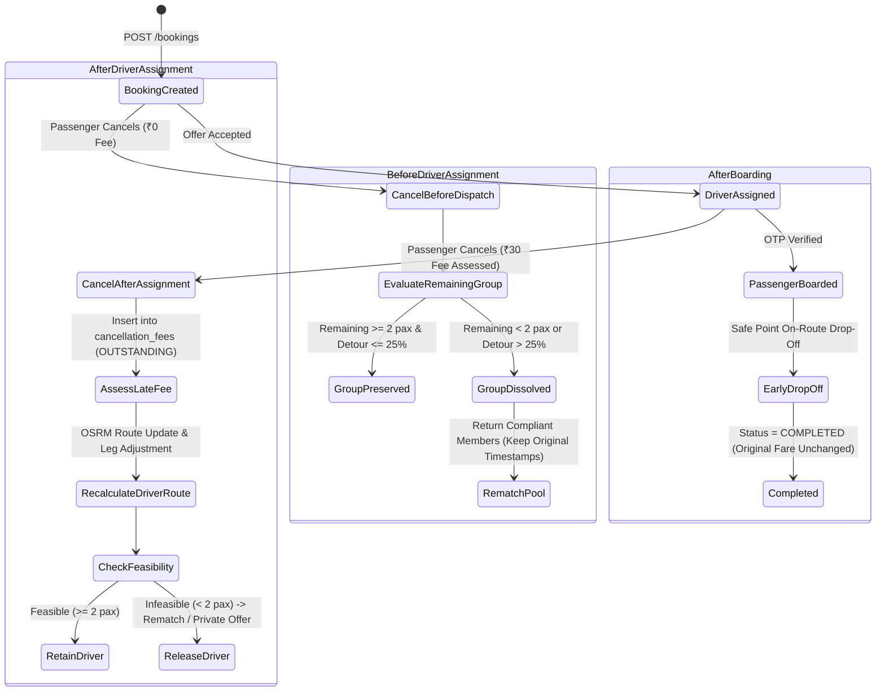
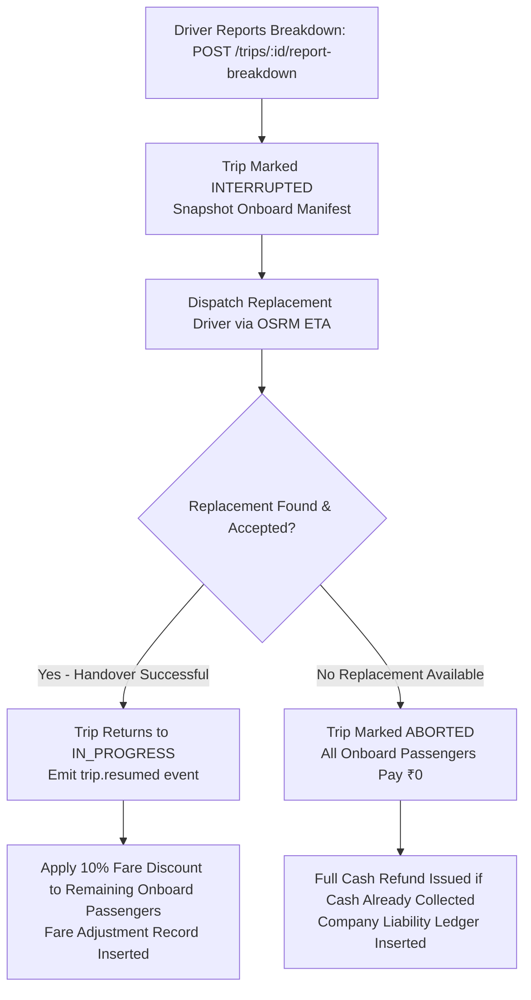

# Fare Calculation and Cancellation Specification

## On-Demand Aggregation Platform for Last-Mile Connectivity Using Shared Micro-Mobility

---

## 1. Approved Tariff Configuration

The tariff is fully versioned, configurable via the `fare_configs` table in PostgreSQL, and managed through the Next.js Admin Portal.

| Tariff Parameter | Approved Default Value | Stored Unit | Description |
|---|---|---|---|
| **Base Boarding Charge ($B$)** | **₹20.00** | `2000` paise | Fixed initial boarding charge for vehicle dispatch. |
| **Per-Kilometer Distance Rate ($R$)** | **₹10.00 / km** | `1000` paise/km | Rate charged per 1,000 metres of road distance. |
| **Minimum Passenger Fare Floor** | **₹20.00** | `2000` paise | Absolute minimum fare below which no passenger can be charged. |
| **Waiting Charge per Minute** | **₹5.00 / min** | `500` paise/min | Surcharge per started minute beyond the free waiting window. |
| **Free Pickup Waiting Window** | **5 minutes** | `300` seconds | Grace period following driver arrival at pickup hub. |
| **Maximum Pickup Waiting Window** | **10 minutes** | `600` seconds | Hard deadline after which unboarded passenger is marked `NO_SHOW`. |
| **Fixed Late Cancellation Fee** | **₹30.00** | `3000` paise | Assessed for passenger cancellation after driver assignment. |
| **Fixed No-Show Fee** | **₹30.00** | `3000` paise | Flat penalty charged when passenger fails to board within 10 minutes. |
| **Breakdown Compensation Discount** | **10%** | `10` percent | Automatic discount on final fare when trip is resumed by replacement. |
| **Surge Pricing Multiplier** | **None (1.0x)** | N/A | Surge pricing is strictly excluded in the MVP. |
| **Payment Method** | **Cash Only** | N/A | Physical cash settlement upon drop-off. |

---

## 2. Shared Fare Allocation Formula

The system implements the **Proportional Solo-Fare Allocation Formula**, ensuring every commuter saves between 20% and 40% compared to a private ride, while guaranteeing that the driver's negotiated total vehicle earnings are fully met.

### 2.1 Mathematical Formulation

1. **Individual Solo Reference Fare ($S_i$):**
   The benchmark cost for passenger $i$ travelling alone directly from pickup origin to destination:
   $$S_i = B + D_i \times R$$
   where:
   - $B = \text{₹}20.00$ (Base Fare)
   - $R = \text{₹}10.00/\text{km} = \text{₹}0.01/\text{metre}$
   - $D_i = \text{direct road distance in metres (obtained via OSRM)}$

2. **Total Shared Vehicle Group Fare ($G$):**
   The total fare earned by the driver for executing the multi-stop shared route:
   $$G = B + D_{\text{shared}} \times R$$
   where:
   - $D_{\text{shared}} = \text{total optimized shared route distance in metres across all drop-offs}$

3. **Individual Allocated Fare ($F_i$):**
   The proportional cost allocated to passenger $i$:
   $$F_i = G \times \frac{S_i}{\sum_{j=1}^{k} S_j}$$
   where $k$ is the total number of passengers in the group ($2 \le k \le 4$).

4. **Guaranteed Fare Invariants:**
   - **Cost Reconciliation Invariant:** $\sum_{i=1}^{k} F_i = G$ (The sum of individual allocated fares must exactly equal the group fare).
   - **Minimum Fare Floor:** $F_i \ge \text{₹}20.00$ for all $i$.
   - **Ceiling Invariant:** $F_i \le \text{AgreedCeiling}_i$ (Allocated fare can never exceed the passenger's private estimated fare).
   - **No Compensatory Subsidization:** If an allocation is infeasible (e.g., $F_i > \text{AgreedCeiling}_i$), the group is **rejected**. The system never increases other passengers' fares to compensate for a shortfall.

---

## 3. High-Precision Decimal Arithmetic and Deterministic Rounding

### 3.1 Integer Paise Storage
To eliminate floating-point rounding errors (e.g., `0.1 + 0.2 = 0.30000000000000004`), all internal monetary math executes using **integer paise** ($1\text{ Rupee} = 100\text{ paise}$). Distances are maintained as integer metres.

### 3.2 Deterministic Whole-Rupee Rounding Procedure
Physical cash transactions in India cannot settle fractional paise. Final individual passenger fares are rounded to whole rupees according to the following deterministic algorithm:

1. **Calculate Base Rupee Rounding:**
   Round each raw allocated fare $F_i$ to the nearest whole rupee:
   $$R_i = \lfloor F_i + 0.50 \rfloor \quad (\text{₹}0.50 \text{ rounds upward})$$
2. **Compute Group Remainder Discrepancy:**
   $$\Delta = G - \sum_{i=1}^{k} R_i$$
   Because rounding individual fares can yield a sum differing by $\pm 1$ or $\pm 2$ rupees from the target group fare $G$, a discrepancy $\Delta$ must be absorbed.
3. **Deterministic Remainder Allocation:**
   - Sort the group members in descending order of their solo reference fare ($S_i \text{ DESC}$).
   - If $\Delta > 0$ (rounded sum is short of driver earnings): Add ₹1.00 to the passenger with the highest solo fare who has remaining headroom below their agreed ceiling ($R_i + 1 \le \text{Ceiling}_i$). Repeat until $\Delta = 0$.
   - If $\Delta < 0$ (rounded sum exceeds driver earnings): Deduct ₹1.00 from the passenger with the highest solo fare whose fare remains above the minimum floor ($R_i - 1 \ge \text{₹}20$). Repeat until $\Delta = 0$.
4. **Final Verification:**
   Confirm $\sum R_i = G$, all $R_i \ge \text{₹}20$, and all $R_i \le \text{Ceiling}_i$.

---

## 4. Worked Numerical Examples

### 4.1 Example 1: 3-Passenger Shared Corridor (Kudasan, Koba, Infocity)
- **Tariff:** $B = \text{₹}20.00$, $R = \text{₹}10.00/\text{km}$ (₹0.01/m).
- **Pickup Origin:** PDEU Main Gate ($P_0$).
- **Passengers:**
  - Passenger 1 ($P_1$, Kudasan): Direct distance $D_1 = 3,500\text{ m} \implies S_1 = 20 + 35.00 = \text{₹}55.00$.
  - Passenger 2 ($P_2$, Koba Circle): Direct distance $D_2 = 5,000\text{ m} \implies S_2 = 20 + 50.00 = \text{₹}70.00$.
  - Passenger 3 ($P_3$, Infocity): Direct distance $D_3 = 7,200\text{ m} \implies S_3 = 20 + 72.00 = \text{₹}92.00$.
- **Sum of Solo Reference Fares:** $\sum S_j = 55 + 70 + 92 = \text{₹}217.00$.
- **Optimized Shared Multi-Stop Route:** $P_0 \rightarrow P_1 \rightarrow P_2 \rightarrow P_3$.
- **Total Shared Road Distance:** $D_{\text{shared}} = 8,800\text{ metres}$.
- **Total Group Fare ($G$):** $G = 20 + 8.8 \times 10 = \text{₹}108.00$.

#### Allocation Calculations:
- $F_1 = 108.00 \times \frac{55.00}{217.00} = \text{₹}27.373 \rightarrow \text{Round to ₹}27.00$
- $F_2 = 108.00 \times \frac{70.00}{217.00} = \text{₹}34.838 \rightarrow \text{Round to ₹}35.00$
- $F_3 = 108.00 \times \frac{92.00}{217.00} = \text{₹}45.788 \rightarrow \text{Round to ₹}46.00$
- **Sum of Rounded Fares:** $27 + 35 + 46 = \text{₹}108.00$.
- **Discrepancy:** $\Delta = 108 - 108 = \text{₹}0.00$. Exact reconciliation achieved.
- **Commuter Savings:**
  - $P_1$: Pays ₹27 instead of ₹55 (**50.9% Savings**).
  - $P_2$: Pays ₹35 instead of ₹70 (**50.0% Savings**).
  - $P_3$: Pays ₹46 instead of ₹92 (**50.0% Savings**).
  - Driver earns ₹108 for an 8.8 km run, significantly higher than any individual solo fare.

### 4.2 Example 2: 4-Passenger Group with Discrepancy Reconciliation
- Passenger solo fares: $S_1 = \text{₹}35.00$, $S_2 = \text{₹}42.00$, $S_3 = \text{₹}58.00$, $S_4 = \text{₹}65.00$.
- $\sum S_j = \text{₹}200.00$.
- Total shared route distance: $D_{\text{shared}} = 9,500\text{ m} \implies G = 20 + 95.00 = \text{₹}115.00$.
- **Allocations:**
  - $F_1 = 115 \times \frac{35}{200} = \text{₹}20.125 \rightarrow \text{Rounded: ₹}20.00$
  - $F_2 = 115 \times \frac{42}{200} = \text{₹}24.150 \rightarrow \text{Rounded: ₹}24.00$
  - $F_3 = 115 \times \frac{58}{200} = \text{₹}33.350 \rightarrow \text{Rounded: ₹}33.00$
  - $F_4 = 115 \times \frac{65}{200} = \text{₹}37.375 \rightarrow \text{Rounded: ₹}37.00$
- **Sum of Rounded Fares:** $20 + 24 + 33 + 37 = \text{₹}114.00$.
- **Discrepancy:** $\Delta = 115 - 114 = +\text{₹}1.00$.
- **Adjustment:** Surcharge ₹1.00 onto the highest solo fare ($P_4$):
  - $F_4 = 37 + 1 = \text{₹}38.00$.
  - New sum: $20 + 24 + 33 + 38 = \text{₹}115.00 = G$. Reconciled.

---

## 5. Fare Quotes and Ceilings (FINAL APPROVED)

The governance policies governing quote lifecycles and fare ceilings are finalized as follows:

| Policy Item | Approved Specification |
|---|---|
| **Fare Quote Validity** | **Exactly 2 minutes** (120 seconds). |
| **Shared Estimate Display** | **Range format** `[₹20.00, Private Estimated Fare]`. |
| **Shared Range Lower Bound** | **₹20.00** (Minimum fare floor). |
| **Shared Range Upper Bound** | **Private Estimated Fare** (Solo reference fare). |
| **Agreed Fare Ceiling** | **Private Estimated Fare** (Immutable contract). |

### 5.1 Quote Lifecycle Rules
1. **At Quote Generation:**
   - The backend calls OSRM for the direct solo distance $D_i$.
   - Computes private estimated fare: $S_i = \text{₹}20 + D_i \times \text{₹}10/\text{km}$.
   - Displays the shared range `[₹20, S_i]` and locks $S_i$ as the `agreed_fare_ceiling`.
   - Records immutable tariff snapshot and expiration timestamp (`expires_at = NOW() + 2m`).
2. **Booking Persistence:**
   - When a booking is created (`POST /bookings`), the booking references the quote UUID, locks the agreed ceiling, and records the tariff version.
   - **Expiry Invariant:** Expiration of the original quote record **does NOT invalidate an already-created booking**. Once a booking is created within the 2-minute window, its agreed fare ceiling remains permanently binding.
   - If a commuter hesitates past 2 minutes before clicking "Book Ride", the client must request a fresh quote before booking creation.

---

## 6. Waiting Charges and No-Show Policies (FINAL APPROVED)

### 6.1 Waiting Charge Formula
Waiting time is tracked authoritatively between the driver's arrival timestamp (`driver_arrived_at`) and the passenger's individual OTP verification timestamp (`boarded_at`).

$$W_i = 5 \times \lceil\max(0, T_i - 5)\rceil$$

where:
- $T_i = \text{waiting time in elapsed minutes}$
- The first 5 minutes are strictly free (₹0).
- After 5 minutes, each started minute incurs a flat ₹5.00 charge.

#### Authoritative Waiting Charge Schedule:

| Waiting Duration ($T_i$) | Waiting Charge ($W_i$) | Operational Explanation |
|---|---:|---|
| **0 min to 5 min 00 sec** | **₹0.00** | Free waiting window. |
| **5 min 01 sec to 6 min 00 sec** | **₹5.00** | 1st started minute over grace period. |
| **6 min 01 sec to 7 min 00 sec** | **₹10.00** | 2nd started minute. |
| **7 min 01 sec to 8 min 00 sec** | **₹15.00** | 3rd started minute. |
| **8 min 01 sec to 9 min 00 sec** | **₹20.00** | 4th started minute. |
| **9 min 01 sec to 10 min 00 sec**| **₹25.00** | 5th started minute (Maximum waiting charge). |

### 6.2 No-Show Policy (10-Minute Threshold)
- If a passenger fails to verify their OTP within **10 minutes** of the driver's arrival:
  - The driver app enables the `DECLARE NO-SHOW` button.
  - The driver clicks the button (`POST /trips/:id/passengers/:id/no-show`).
  - The backend marks that passenger `status = 'NO_SHOW'`.
  - Assesses a **flat ₹30.00 no-show fee** inserted into `cancellation_fees` as `'OUTSTANDING'`.
  - **No Additional Waiting Charge:** Unboarded no-show passengers **are NOT additionally charged waiting fees**. The penalty is strictly capped at the flat ₹30 fee.
  - The vehicle departs with remaining passengers; the route is recalculated for remaining members without penalizing compliant commuters.

---

## 7. Cancellation and Fare Recalculation Engine



### 7.1 Passenger Cancellation Scenarios

#### Scenario 1: Cancellation Before Driver Assignment
- **Fee:** **₹0.00** (Free cancellation).
- **Workflow:**
  1. Booking status set to `'CANCELLED'`.
  2. Passenger removed from `group_members` (`is_active_member = false`).
  3. `group_version` incremented ($v \rightarrow v+1$).
  4. Backend evaluates remaining active members:
     - If $\ge 2$ passengers and detour $\le 25\%$, the group is preserved, route recalculated, and dispatch continues.
     - If $< 2$ passengers or detour $> 25\%$, the group is dissolved (`'DISSOLVED'`). Compliant members return to the matching pool with their **original booking creation timestamps strictly preserved**.

#### Scenario 2: Cancellation After Driver Assignment
- **Fee:** **Fixed ₹30.00 Late Fee** inserted into `cancellation_fees` (`status = 'OUTSTANDING'`).
- **Workflow:**
  1. Booking status set to `'CANCELLED'`.
  2. Member removed, `group_version` incremented.
  3. Driver route recalculated via OSRM.
  4. If remaining group remains feasible ($\ge 2$ passengers), driver assignment is maintained; navigation polyline updates automatically.
  5. If remaining group is infeasible ($< 2$ passengers), driver assignment is released; driver receives priority dispatch in queue. Remaining passenger is offered fee-free private conversion or rematching.

#### Scenario 3: After Boarding
- Ordinary cancellation is **unavailable**.
- If a passenger demands to disembark early, the **Early Drop-Off Policy** applies:
  - Disembarkation allowed only at a safe point already on the vehicle's agreed route.
  - Driver confirms drop-off (`POST /trips/:id/passengers/:id/complete`).
  - Journey marked `'COMPLETED'`.
  - **The original allocated fare remains completely unchanged.**
  - Other passengers' fares and the vehicle route remain unchanged.

---

## 8. Driver Breakdown and Mid-Trip Failure Compensation

In the event of an unavoidable vehicle breakdown (flat tire, mechanical failure, accident) during an active shared trip:



### 8.1 Successful Replacement Handover
- Trip status returns to `'IN_PROGRESS'`.
- `trip.resumed` is emitted as an event (not a permanent state).
- **10% Compensation Discount:** All passengers who were still onboard at the moment of breakdown receive an automatic **10% discount** off their final allocated ride fare:
  $$F_{\text{discounted}} = F_{\text{allocated}} \times 0.90$$
  - Applied exactly once per affected passenger.
  - Disclosed on driver cash collection screen.
  - Passengers already dropped off prior to the breakdown receive no discount.

### 8.2 Replacement Failure (Aborted Trip)
- If no replacement driver with sufficient capacity is available within acceptable time:
  - Trip status marked `'ABORTED'`.
  - **All affected onboard passengers pay ₹0.00.**
  - If cash was handed over to the original driver prior to the incident, a full physical cash refund is mandated and audited.
  - Zero cancellation fees or no-show fees are assessed.
  - Platform records the operational loss in `refund_records`.

---

## 9. Cash Collection and Next-Ride Fee Surcharge Ledger

### 9.1 Surcharge on Next Ride Workflow
Because the platform operates without credit card auto-debits, uncollected ₹30 late cancellation and no-show fees are recovered on the passenger's subsequent ride:

1. **Disclosure:** When a passenger with an `OUTSTANDING` fee requests a new fare quote, the API returns the ride estimate *plus* the outstanding fee:
   ```json
   {
     "rideFare": "38.00",
     "outstandingLateFeeSurcharge": "30.00",
     "totalCashToCollect": "68.00"
   }
   ```
2. **Collection:** Upon drop-off, the driver app displays:
   - Base Ride Fare: ₹38.00
   - Prior Late Fee Surcharge: ₹30.00
   - **Total Cash to Collect: ₹68.00**
3. **Atomic Reconciliation:**
   When the driver calls `POST /payments/confirm-cash` with `amountCollectedPaise = 6800`:
   - Inserts `cash_collections` record.
   - Inserts `payment_allocations` for ride fare (₹38) and surcharge (₹30).
   - Atomically updates `cancellation_fees SET status = 'COLLECTED', collected_booking_id = :bookingId, collected_at = NOW()`.
   - **Partial Unique Index Protection:** Guarantees that a cancellation fee can never be collected twice.

### 9.2 Admin Cancellation Fee Waiver
- **Privileged Exemption:** Platform administrators (`ADMIN` role) can exempt passengers from outstanding late fees upon verified justification (e.g. campus medical emergency, platform technical failure).
- **Endpoint:** `POST /api/v1/admin/cancellation-fees/:id/waive`.
- **Preconditions:** Only `OUTSTANDING` fees can be waived. Already `COLLECTED` fees are rejected with 400 `FEE_ALREADY_COLLECTED`.
- **Authoritative Audit Record:** Updates existing `cancellation_fees` record:
  - `status = 'WAIVED'`
  - `waived_by_user_id = :adminUserId`
  - `waiver_reason = :waiverReason` (non-empty justification)
  - `waived_at = NOW()`
- **Immutability & Safe Repeated Attempts:** Existing waiver audit metadata remains strictly immutable. Repeated calls on an already waived fee return 200 OK without mutating the recorded reason, timestamp, or admin ID.
- **Outbox Emission:** Emits `CANCELLATION_FEE_WAIVED` event through transactional outbox.
- **Immediate Quote Relief:** Once marked `WAIVED`, the fee is immediately excluded from subsequent quote surcharge aggregation (`outstandingLateFeeSurcharge = '0.00'`).

---

*End of Fare Calculation and Cancellation Specification*
