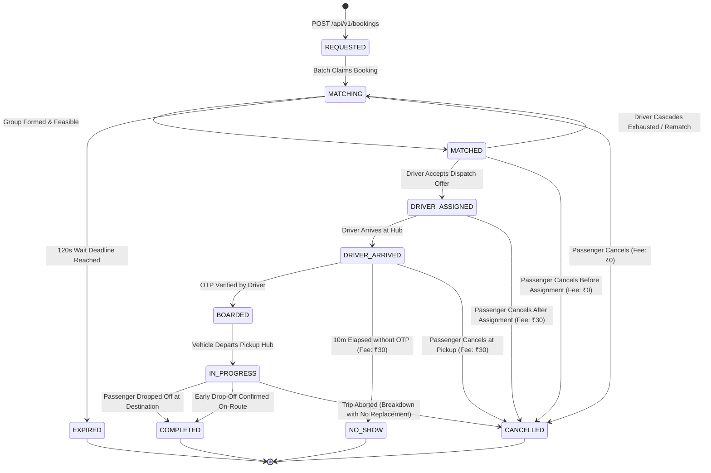
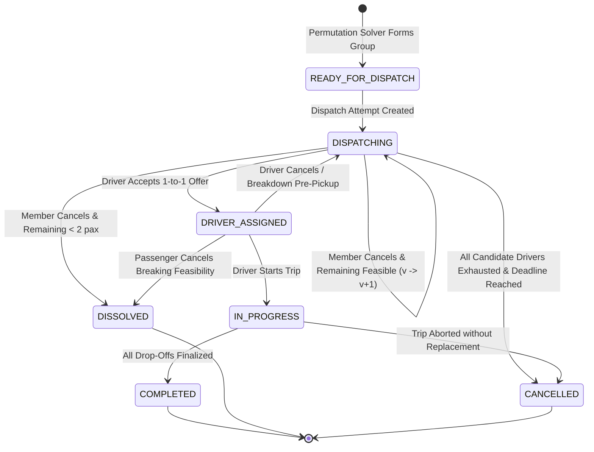
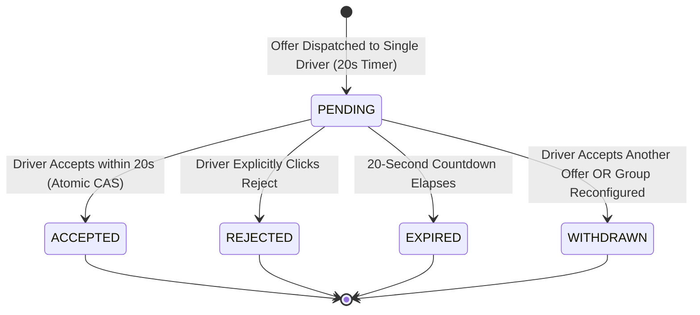
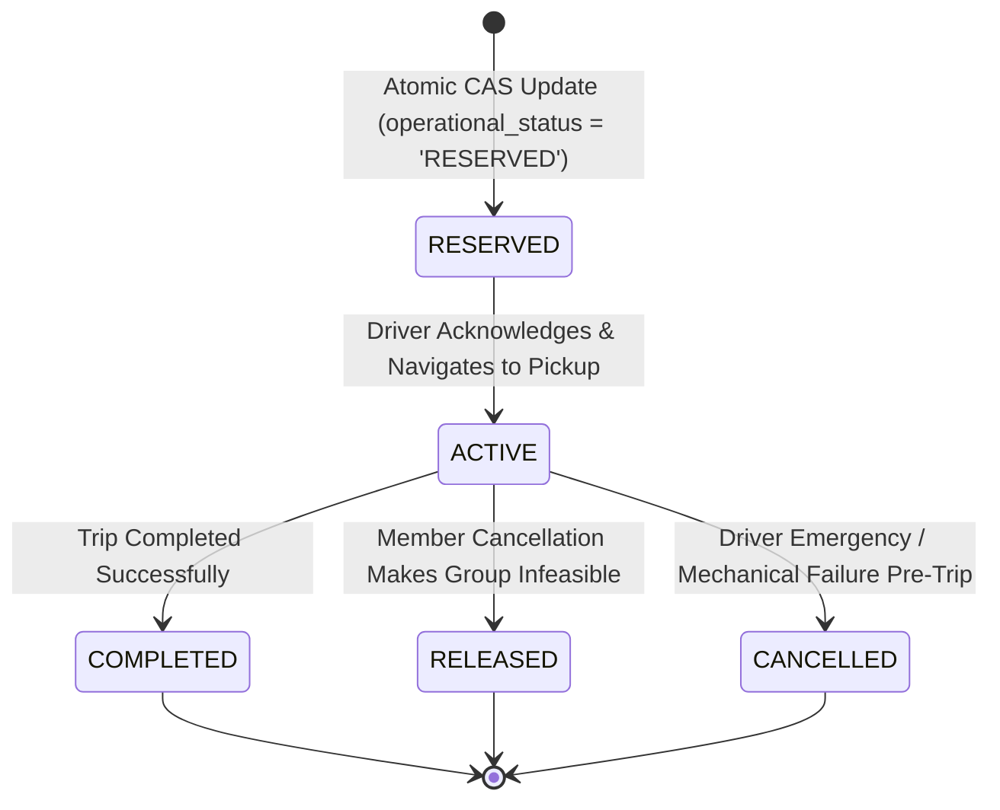
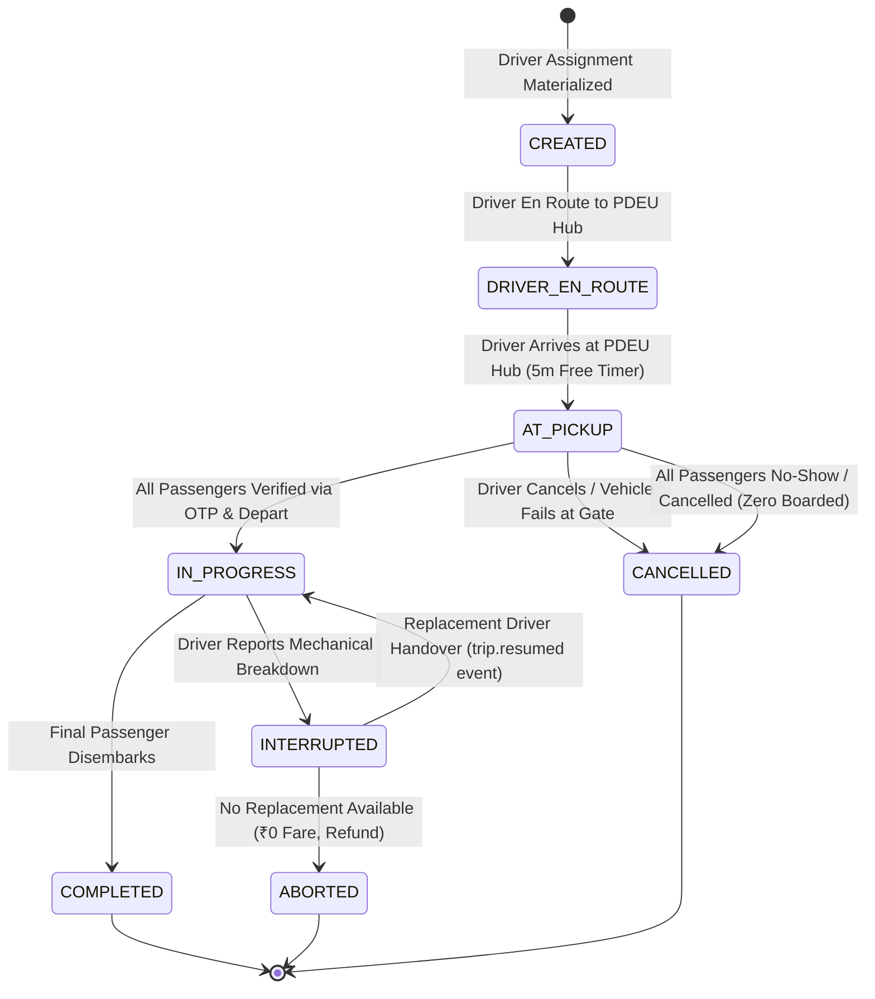
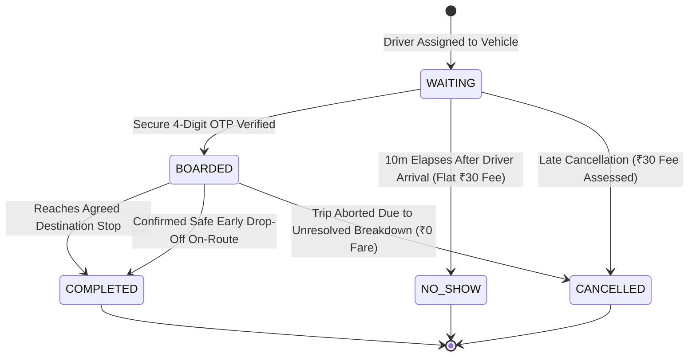
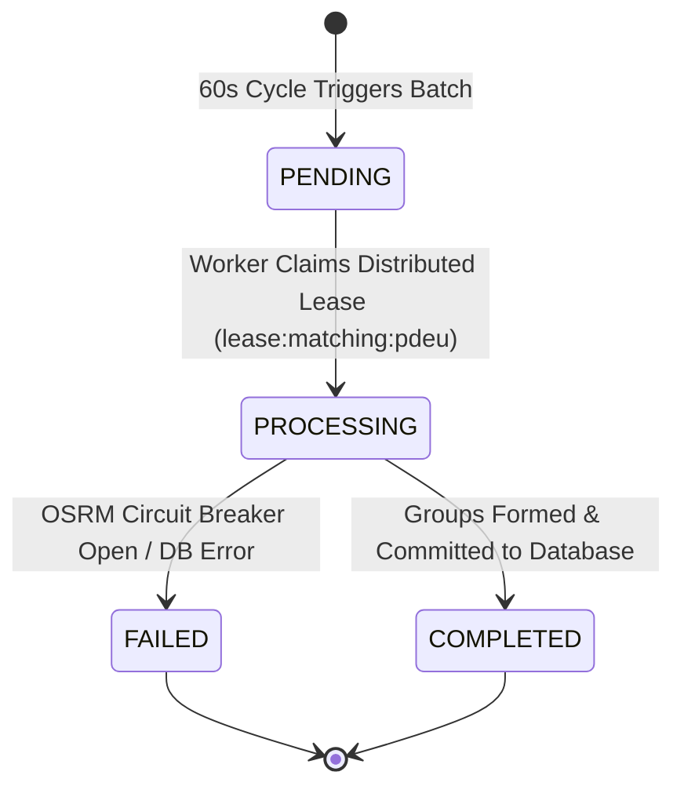
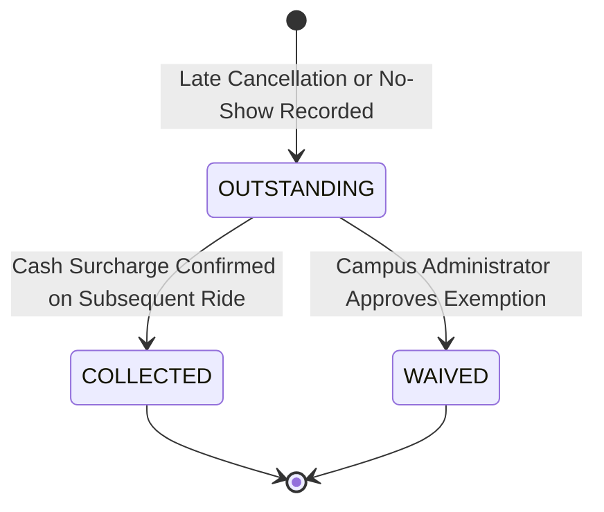

# State Machines and Entity Lifecycles Specification

## On-Demand Aggregation Platform for Last-Mile Connectivity Using Shared Micro-Mobility

---

## 1. Architectural Modeling Principles

To eliminate ambiguity and prevent synchronization deadlocks, the platform enforces strict entity separation:
1. **Separation of Vehicle Trip vs. Passenger Journey:** The physical vehicle trip (`trips`) follows vehicle-level progression (en route, at pickup, executing multi-stop route, completed). Individual passenger journeys (`trip_passengers` / `bookings`) follow commuter-level milestones (boarded via OTP, dropped off, completed, no-show).
2. **`trip.resumed` is an Event, NOT a State:** When a replacement driver takes over an interrupted trip, the trip status returns to `'IN_PROGRESS'`. The resumption is an instantaneous domain event (`trip.resumed`) that triggers notifications and discount calculations, not a separate persistent database state.
3. **Immutable History Tracking:** State transitions are audited in dedicated append-only tables (`booking_status_history`, `trip_status_history`, `outbox_events`).

---

## 2. Master State Machine Diagrams

### 2.1 Booking State Machine

### 2.2 Ride Group State Machine

### 2.3 Driver Dispatch Offer State Machine

### 2.4 Driver Assignment State Machine

### 2.5 Vehicle Trip State Machine

### 2.6 Trip Passenger Individual Journey State Machine

### 2.7 Matching Batch State Machine

### 2.8 Cancellation Fee Ledger State Machine

---

## 3. Comprehensive State Transition Tables

### 3.1 Booking Entity Transitions

| Current State | Trigger / Event | Target State | Actor / Initiator | Preconditions | Side Effects & Actions |
|---|---|---|---|---|---|
| `[None]` | `POST /bookings` | `REQUESTED` | Passenger | Pickup within 150m geofence; quote valid; no other active booking. | Inserts `bookings`, inserts `outbox_events` (`BOOKING_CREATED`). |
| `REQUESTED` | Batch Claim | `MATCHING` | Matching Worker | Matching batch claimed zone lease. | Enrolls in `matching_batch_bookings`. |
| `MATCHING` | Group Formed | `MATCHED` | Permutation Solver | Feasible group with detour $\le 25\%$ and fare $\le$ ceiling. | Enrolls in `group_members`; links `ride_group_id`. |
| `MATCHING` | 120s Timeout | `EXPIRED` | Worker Scheduler | `max_wait_deadline <= NOW()`. | Emits `booking.expired`. Offers private conversion or exit. |
| `MATCHING` | User Cancels | `CANCELLED` | Passenger | Cancellation requested before assignment. | Marks `CANCELLED`, fee = ₹0. Removes from batch. |
| `MATCHED` | Driver Accepts | `DRIVER_ASSIGNED` | Driver | Driver accepted 1-to-1 dispatch offer within 20s. | Emits `booking.status.updated` with driver ETA. |
| `MATCHED` | User Cancels | `CANCELLED` | Passenger | Cancellation requested before assignment. | Marks `CANCELLED`, fee = ₹0. Group recalculated. |
| `DRIVER_ASSIGNED` | Driver Arrives | `DRIVER_ARRIVED` | Driver | Driver clicks "Arrived" at PDEU hub. | Starts individual 5-minute free waiting timer. |
| `DRIVER_ASSIGNED` | User Cancels | `CANCELLED` | Passenger | Cancellation requested after driver assignment. | Marks `CANCELLED`. Inserts ₹30 into `cancellation_fees` (`OUTSTANDING`). |
| `DRIVER_ARRIVED` | OTP Verified | `BOARDED` | Driver | Correct 4-digit OTP hash match. | Stops waiting timer; verifies passenger presence. |
| `DRIVER_ARRIVED` | 10m Elapsed | `NO_SHOW` | Driver | 10m elapsed since `driver_arrived_at`. | Marks `NO_SHOW`. Inserts flat ₹30 fee. Waiting fee = ₹0. |
| `BOARDED` | Vehicle Starts | `IN_PROGRESS` | Driver | All unboarded passengers handled. | Sets vehicle trip `'IN_PROGRESS'`. |
| `IN_PROGRESS` | Drop-Off | `COMPLETED` | Driver | Driver confirms drop-off at destination or early point. | Marks journey `COMPLETED`. Driver collects cash. |
| `IN_PROGRESS` | Trip Aborted | `CANCELLED` | Backend Incident | Breakdown with no replacement driver found. | Passenger pays ₹0. Full cash refund if collected. |

---

### 3.2 Trip Entity Transitions

| Current State | Trigger / Event | Target State | Actor / Initiator | Preconditions | Side Effects & Actions |
|---|---|---|---|---|---|
| `[None]` | Offer Accepted | `CREATED` | Dispatch Worker | Winning driver accepted offer. | Materializes `trips` and `trip_passengers`. |
| `CREATED` | Navigating | `DRIVER_EN_ROUTE` | Driver | Driver opens navigation to PDEU pickup. | Streams GPS updates to passenger room. |
| `DRIVER_EN_ROUTE` | Arrival Click | `AT_PICKUP` | Driver | Driver device within pickup geofence. | Sets `driver_arrived_at = NOW()`. Emits `driver.arrived`. |
| `AT_PICKUP` | Trip Start | `IN_PROGRESS` | Driver | All passenger OTPs verified or marked no-show; $\ge 1$ boarded. | Emits `trip.started`. Navigation begins. |
| `AT_PICKUP` | All Passengers No-Show / Cancelled | `CANCELLED` | Driver / Worker | Zero passengers boarded; all manifest members NO_SHOW or CANCELLED. | Marks trip `CANCELLED`, dissolves group, releases driver assignment and profile to `AVAILABLE`. Emits `TRIP_CANCELLED`. |
| `IN_PROGRESS` | Breakdown | `INTERRUPTED` | Driver / Admin | Mechanical failure, tire blowout, accident. | Captures immutable manifest snapshot. Searches replacement. |
| `INTERRUPTED` | Replacement Accepts | `IN_PROGRESS` | Replacement Driver | Replacement driver within capacity accepts handover. | Emits `trip.resumed` event. Applies 10% discount to onboard members. |
| `INTERRUPTED` | Replacement Fails | `ABORTED` | Worker Scheduler | No eligible replacement within timeout. | Sets trip `ABORTED`. Onboard passengers pay ₹0. Full refund. |
| `IN_PROGRESS` | Final Drop-Off | `COMPLETED` | Driver | All passenger journeys finalized. | Sets trip `COMPLETED`. Driver status $\rightarrow$ `AVAILABLE`. |

---

### 3.3 Cancellation Fee Ledger Transitions

| Current State | Trigger / Event | Target State | Actor / Initiator | Preconditions | Side Effects & Actions |
|---|---|---|---|---|---|
| `[None]` | Late Cancellation | `OUTSTANDING` | Passenger / Worker | Cancelled after driver assigned (`DRIVER_ASSIGNED` or `DRIVER_ARRIVED`). | Inserts `cancellation_fees` record (₹30.00). Invariant 7 enforced. |
| `[None]` | Passenger No-Show | `OUTSTANDING` | Driver | 10 minutes elapsed at hub without OTP verification. | Inserts `cancellation_fees` record (flat ₹30.00 penalty, ₹0 waiting fee). |
| `OUTSTANDING` | Driver Cash Confirmation | `COLLECTED` | Driver | Passenger drop-off completed on subsequent ride; cash collected. | Atomically updates fee `COLLECTED`, sets `collected_booking_id` and `collected_at`. Inserts `payment_allocations`. |
| `OUTSTANDING` | Admin Waiver | `WAIVED` | Administrator | Authenticated `ADMIN`; valid non-empty waiver reason supplied. | Atomically updates fee `WAIVED`, sets `waived_by_user_id`, `waiver_reason`, and `waived_at`. Emits `CANCELLATION_FEE_WAIVED`. |

---

## 4. Forbidden and Invalid Transitions

The database engine, Prisma middleware, and API controllers strictly block the following invalid transitions:

1. **`COMPLETED` $\rightarrow$ Any State:** Once a booking or trip is marked `COMPLETED`, its financial and operational records are immutable.
2. **`CANCELLED` $\rightarrow$ `IN_PROGRESS`:** A cancelled booking cannot be resurrected. Commuters must request a fresh quote and create a new booking.
3. **`IN_PROGRESS` $\rightarrow$ `CANCELLED` (Ordinary Passenger Cancellation):** Once a passenger has verified their OTP and boarded, ordinary cancellation is disabled. The only exit paths are `COMPLETED` (via normal or early drop-off) or trip abortion due to unresolved breakdown.
4. **`NO_SHOW` $\rightarrow$ `BOARDED`:** Once a passenger is declared a no-show after 10 minutes, their boarding OTP is invalidated; the driver cannot board that passenger.
5. **Multiple Active Groups per Booking:** Enforced by partial unique index `idx_unique_active_booking_in_group`. A booking cannot transition to `MATCHED` in Group B if it is active in Group A.
6. **Multiple Active Assignments per Driver:** Enforced by partial unique index `idx_unique_active_driver_assignment`. A driver cannot transition to `RESERVED` or `ACTIVE` if an existing assignment is incomplete.

---

*End of State Machines and Entity Lifecycles Specification*
